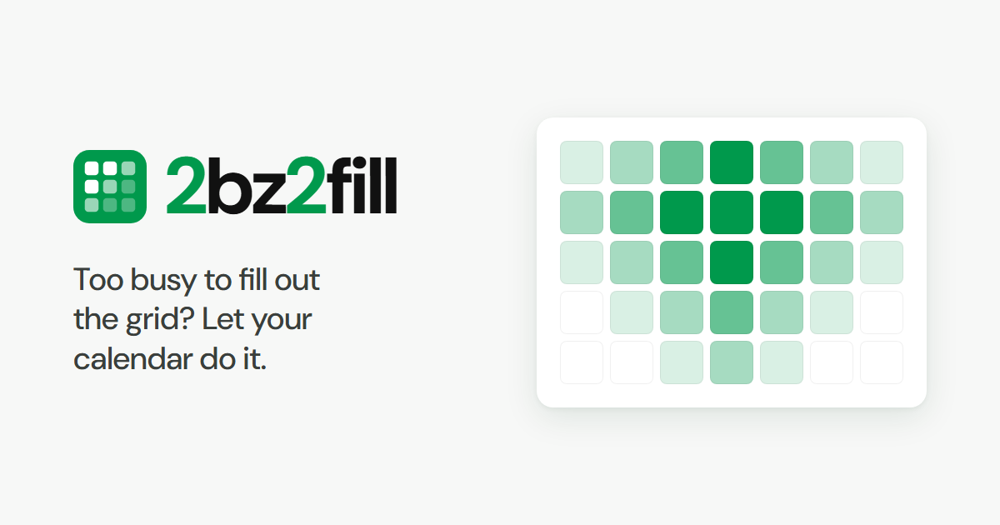

**2bz2fill** is a group availability poll for people who are too busy to fill out a long
When2meet-style grid. Every feature is judged by one question: does it make responding take less
effort?

It is a fork of [Timeful](https://github.com/schej-it/timeful.app) (formerly Schej), an open-source
scheduling app by Jonathan Liu and contributors. Thank you to them: the poll grid, calendar
integrations, time zone handling and most of the code here are theirs.

Built with [Vue 2](https://github.com/vuejs/vue), [MongoDB](https://github.com/mongodb/mongo),
[Go](https://github.com/golang/go), and [TailwindCSS](https://github.com/tailwindlabs/tailwindcss).

## How it differs from Timeful

Timeful is a general scheduling poll. 2bz2fill keeps its features and focuses on cutting the work
of responding. Planned, in order:

1. Upload an `.ics` file to fill the grid from any calendar app, with no account or sign-in.
2. Save "my usual week" once and have every new poll arrive pre-filled from it.
3. Fast manual tools: mark busy times instead of free ones, fill or clear a whole day, copy a day,
   reuse your last response.
4. Pre-filled responses you only need to check and confirm.
5. A grid that works well on a phone.

The Timeful-specific parts (their branding, blog, socials, analytics, donation links and the
When2meet converter, which runs on Timeful's own servers) have been removed.

## Features inherited from Timeful

- See when everybody's availability overlaps
- Date and time ranges, or days of the week
- Autofill from Google Calendar, Outlook, Apple Calendar or an ICS feed URL
- "Available" vs. "If needed" times
- See when a subset of people are available
- Time zone support
- Email notifications and reminders
- Duplicating polls, availability groups, CSV export
- Only show responses to the event creator
- Import a poll (with its responses) from a 2bz2fill or Timeful link

## Plugin API

Browser plugins can get and set availability on a poll programmatically. See the
[Plugin API docs](./PLUGIN_API_README.md).

## Self-hosting

See the [Deployment Guide](./DEPLOYMENT.md) for Docker Compose and NixOS setup. Set `BASE_URL` in
`server/.env` to the site's public address; until it is set, emails link to the placeholder
`https://2bz2fill.example`. Analytics are off unless you set your own PostHog key or Google Tag
Manager ID in `frontend/.env` (see `frontend/.env.template`).

## License

[GNU AGPL v3](./LICENSE), the same as Timeful. If you run a modified copy as a public website, you
must offer its source code to your users; the site footer links to this repository for that reason.
